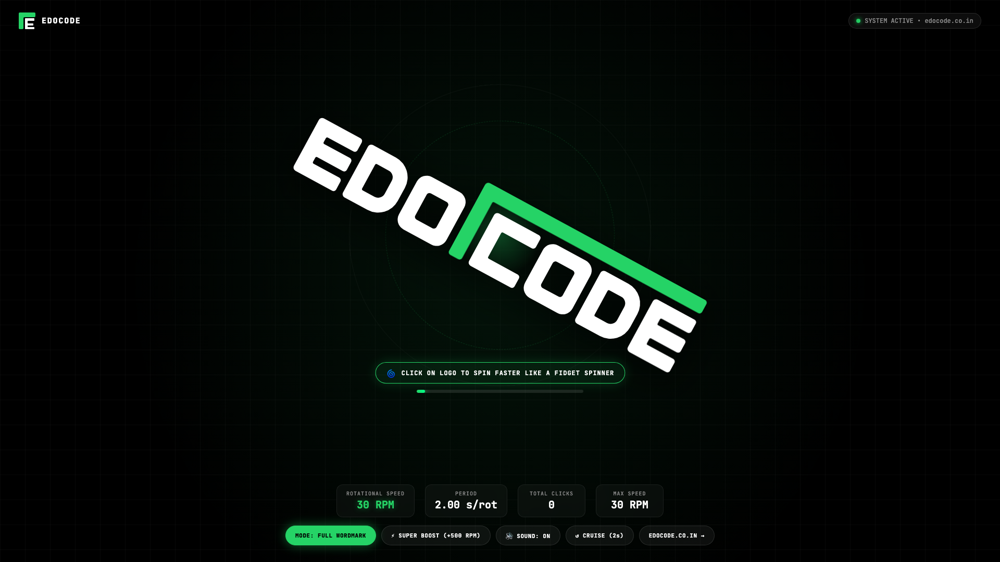

# EDOCODE • Interactive Fidget Spinner

> Interactive temporary landing page for [edocode.co.in](https://edocode.co.in) featuring the palindromic rotational logo with physics-based fidget spinner mechanics.

## Features

- **2.0s Rotational Cruise**: The palindromic wordmark `EDOCODE` (`EDO` on left, `ODE` on right with snake overline) cruises smoothly at 2.0s per rotation (30 RPM).
- **Fidget Spinner Physics**:
  - Click anywhere on the logo to inject angular momentum (+380°/s).
  - Ceramic skateboard bearing friction physics smoothly glides speed back down to cruise pace.
  - Reaches supersonic speeds (> 1000 RPM) with rapid clicking!
- **Dynamic Speedometer & Cursor HUD**:
  - Custom floating pill follows mouse with real-time RPM updates (`CLICK TO SPIN FASTER 🌀`).
  - Speedometer gauge fills up as rotational velocity climbs.
- **Synthesized Audio & Particle Sparks**:
  - Web Audio API procedural ceramic bearing hum and mechanical ratchet clicks (zero external audio files).
  - Neon green `#25D366` spark explosion at click coordinates.
- **Dual Visual Modes**:
  - `Mode 1`: Full wordmark rotational spinner.
  - `Mode 2`: Official `edocode-mark` central hub with dual-wing rotor blades.

## Deployment

Designed as a zero-dependency standalone page. Can be deployed instantly on:
- **GitHub Pages**: Custom domain `edocode.co.in` via included `CNAME`.
- **Vercel**: Import repository and deploy in 1 click.
- **Cloudflare Pages / Netlify**: Direct static drag-and-drop.

---
© 2026 EDOCODE Systems. All rights reserved.
